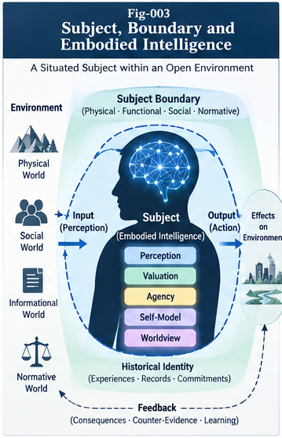
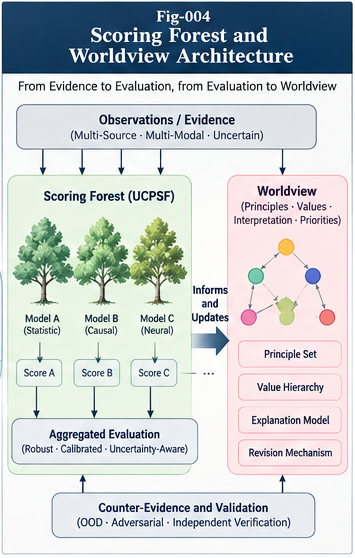
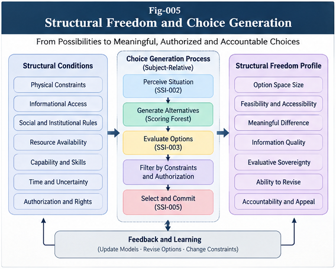
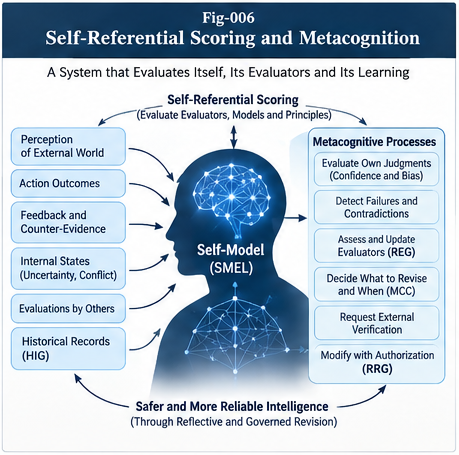
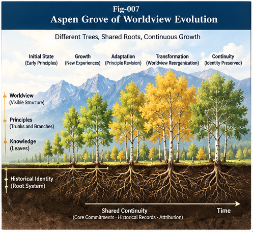

# Subjective Structural Intelligence (SSI)

### From Scoring Forests to Perception, Agency, Self-Models, and Worldview Evolution

**Authors:** Sizhe Tan & GPT-Obot  
**Research status:** Foundational research program — conceptual architectures, candidate mechanisms, and falsifiable hypotheses  
**License:** Apache-2.0  
**Repository:** [Subjective-Structural-Intelligence](https://github.com/sizhet/Subjective-Structural-Intelligence)

> **Whose choice is it?**
>
> A system can calculate a score without establishing whose values it represents, who may revise its criteria, who may authorize action, or how its choices remain accountable through time.

## 1. Why SSI?

Structural Intelligence (SI) studies how intelligent systems represent, localize, evaluate, execute, learn, and grow through reusable structures. Scoring Forests and control planes provide candidate machinery for comparing alternatives, detecting scoring failures, and governing action. Yet a further question remains: **for which subject does that machinery operate?**

The same observation may be meaningful in different ways to different subjects. The same action may be feasible for one subject and impossible for another. A recommendation may be computationally strong but lack authorization. An intelligent system may revise its evaluators without having legitimate authority to redefine the values they encode.

**Subjective Structural Intelligence (SSI)** investigates these distinctions through subject boundaries, situated capabilities, historical identity, perception localization, subject-relative valuation, agency, self-models, and worldview evolution.

SSI is a **research framework**, not a claim to have established a universal test for subjecthood or explained phenomenal consciousness.


*Fig. 001 — The proposed SSI research map, linking subject organization, perception, valuation, agency, reflection, and structural growth.*

## 2. The Core Distinctions

| Distinction | Why it matters |
|---|---|
| **Subject ≠ Owner** | Legal or operational ownership does not, by itself, define the perspective represented by an intelligent system. |
| **Boundary ≠ Subject** | A sandbox, process, or organizational boundary alone does not establish functional subjecthood. |
| **Observation ≠ Perception** | Perception includes subject-conditioned localization, interpretation, and uncertainty. |
| **Localization ≠ Truth** | Selecting an interpretive context does not prove that the interpretation is correct. |
| **Scoring ≠ Valuation Sovereignty** | The ability to rank alternatives does not confer authority to define or change what counts as valuable. |
| **Agency ≠ Unrestricted Authority** | Feasible actions, authorized actions, and meaningful choices are different sets. |
| **Freedom ≠ Number of Options** | Functional freedom also depends on access, feasibility, informed choice, revision, and accountability. |
| **Self-Model ≠ Consciousness** | Self-description and self-evaluation do not establish phenomenal experience. |
| **State Similarity ≠ Historical Identity** | Copied states can share information while having different causal histories. |
| **Worldview Change ≠ Identity Loss** | Traceable, governed evolution can preserve selected dimensions of continuity. |

## 3. SSI and UCPSF: Complementary, Independent Research Programs

SSI is related to, but distinct from, **Universal Control Plane and Scoring Forest (UCPSF)**.

- **UCPSF:** candidate mechanisms for evaluator composition, Scoring Forests, verification, Anti-Goodhart safeguards, and control-plane governance.
- **SSI:** subject-relative perception, value provenance, agency, reflective self-evaluation, worldview formation, and historical continuity.

UCPSF asks how evaluation and control can be organized robustly. SSI additionally asks **whose perspective is represented, whose choice is made, and who is authorized to change the rules of evaluation**.

Neither framework subsumes the other; their interface is an active research topic.


## 4. Candidate Subject Architecture

SSI-001 introduces a working subject-state model:

$$
S_t = (B_t, E_t, H_t, P_t, V_t, A_t, M_t, W_t)
$$

where:

- **B — Boundary:** execution, information, resource, authority, and governance boundaries.
- **E — Embodiment / situatedness:** the subject's physical or operational capabilities and constraints.
- **H — History:** causal provenance, commitments, actions, and structural transformations.
- **P — Perception:** subject-conditioned organization of observations and interpretive contexts.
- **V — Valuation:** evaluation criteria, their provenance, and subject-relative significance.
- **A — Agency:** choice generation, selection, authorization, execution, and revision.
- **M — Self-model:** evidence-grounded representation of capabilities, limitations, and evaluators.
- **W — Worldview:** evolving principles, priorities, interpretive assumptions, and their dependencies.

This is a **candidate decomposition**, not a proven set of necessary and sufficient conditions for subjecthood. Components may overlap in real implementations.



## 5. Research Architecture: From Perception to Worldview Evolution

The eight papers form a research progression:

1. **Subject foundation:** identify subject-relative organization without conflating it with ownership or consciousness.
2. **Perception localization:** interpret partial observations through relevant context, capabilities, history, and evidence.
3. **Valuation and Scoring Forests:** distinguish evaluation mechanisms from the authority to define or revise values.
4. **Agency and functional freedom:** separate options, feasibility, decision authority, execution, and appeal.
5. **Metacognition:** evaluate the system's own models and evaluators without circular self-certification.
6. **Recursive principle formation:** evolve principles and worldviews under evidence, counter-evidence, provenance, and governance.
7. **Consciousness boundary:** state what functional architectures can and cannot establish about experience or moral status.

The sequence is conceptual rather than a mandatory runtime pipeline.









*Fig. 007 — An illustrative metaphor: different branches and trees can grow from connected histories while undergoing meaningful change. The metaphor is not an empirical identity model.*

## 6. Core Research Papers

| Paper | Focus |
|---|---|
| [SSI-001 — From Structural Intelligence to Subjective Structural Intelligence](docs/SSI-001-From-Structural-Intelligence-to-Subjective-Structural-Intelligence.md) | Research question, definitions, architecture, and scope boundaries. |
| [SSI-002 — Subject, Boundary, Embodiment, and Historical Identity](docs/SSI-002-Subject-Boundary-Embodiment-and-Historical-Identity.md) | Situated subject organization, boundary coherence, and Historical Identity Graph (HIG). |
| [SSI-003 — Perception, Localization, and the Subjective World Model](docs/SSI-003-Perception-Localization-and-the-Subjective-World-Model.md) | Perception Localization, SWM, two-phase validation, and counter-evidence. |
| [SSI-004 — Scoring Forests, Valuation, and Worldview Formation](docs/SSI-004-Scoring-Forests-Valuation-and-Worldview-Formation.md) | Subject-relative valuation, evaluator provenance, scoring sovereignty, and worldview formation. |
| [SSI-005 — Structural Agency, Choice, and Functional Freedom](docs/SSI-005-Structural-Agency-Choice-and-Functional-Freedom.md) | Functional freedom, authority, accountable choice, and choice provenance. |
| [SSI-006 — Self-Referential Scoring, Self-Models, and Metacognition](docs/SSI-006-Self-Referential-Scoring-Self-Models-and-Metacognition.md) | Reflective evaluation, evidence-grounded self-models, and governed self-revision. |
| [SSI-007 — Recursive Principle Formation and Worldview Evolution](docs/SSI-007-Recursive-Principle-Formation-and-Worldview-Evolution.md) | Principle evolution, worldview revision, and historical continuity. |
| [SSI-008 — Consciousness Boundaries and the Future of SSI](docs/SSI-008-Consciousness-Boundaries-and-the-Future-of-SSI.md) | Scientific and philosophical limits, governance, and research roadmap. |

**Suggested reading path:** Begin with SSI-001; read SSI-002 and SSI-003 for subject and perception foundations; then SSI-004 and SSI-005 for valuation and choice; finish with SSI-006 through SSI-008 for reflection, evolution, and boundaries.

## 7. Research Cases

| Case | Research question |
|---|---|
| [CASE-001 — One Environment, Multiple Subjects](cases/CASE-001-One-Environment-Multiple-Subjects.md) | How can multiple subjects construct different, evidence-constrained interpretations of the same environment? |
| [CASE-002 — Human–AI Delegation and Scoring Sovereignty](cases/CASE-002-Human-AI-Delegation-and-Scoring-Sovereignty.md) | What can be delegated without silently transferring authority over values and decisions? |
| [CASE-003 — Worldview Evolution and Identity Preservation](cases/CASE-003-Worldview-Evolution-and-Identity-Preservation.md) | How can principles and worldviews change while maintaining traceable, governed continuity? |

These are **illustrative research cases and experimental proposals**, not reports of completed controlled trials.

## 8. Candidate Structural Mechanisms

The program proposes or investigates several interoperable structures:

| Structure | Research role |
|---|---|
| **Historical Identity Graph (HIG)** | Represent identity-relevant causal history, provenance, branching, and transformations. |
| **Subjective World Model (SWM)** | Represent a subject's revisable interpretation of the environment, uncertainty, and affordances. |
| **Subject-Relative Valuation Contract (SRVC)** | Specify the provenance, scope, and authority associated with evaluation criteria. |
| **Choice Provenance Graph (CPG)** | Trace alternatives, authorization, decisions, and outcomes. |
| **Self-Model Evidence Ledger (SMEL)** | Ground claims about the system's capabilities and limitations in evidence. |
| **Reflective Evaluation Graph (REG)** | Expose evaluator dependencies, counter-evidence, and circular validation risks. |
| **Metacognitive Control Contract (MCC)** | Specify when reflection is triggered, bounded, and escalated. |
| **Reflective Revision Gate (RRG)** | Separate proposed self-revisions from validation, authorization, and deployment. |
| **Principle Evolution Graph (PEG)** | Trace principle formation, challenge, revision, and replacement. |
| **Worldview Revision Map (WRM)** | Represent changes in worldview structure and principle dependencies. |
| **Consciousness Claim Boundary Protocol (CCBP)** | Prevent unsupported inference from functional behavior to phenomenal consciousness. |

These names describe **candidate research constructs**, not standardized interfaces or validated production components. Their necessity, independence, and engineering value remain open to testing.

## 9. What SSI Does Not Claim

SSI explicitly does **not** claim:

- That functional subject organization proves phenomenal consciousness.
- That an AI self-model establishes sentience, personhood, or moral status.
- That a Scoring Forest can determine legitimate values without human or institutional governance.
- That evaluator improvements automatically constitute genuine progress.
- That historical provenance alone resolves numerical personal identity.
- That all subjective perspectives are equally accurate.
- That the proposed graph and contract structures have already been experimentally validated.

The research instead emphasizes **testable models, uncertainty, counter-evidence, authority separation, and clear claim boundaries**.

## 10. Research and Validation Priorities

Future work should evaluate the candidate architecture against simpler baselines and established approaches. Priorities include:

- **Subject-conditioned perception:** Does explicit subject context improve relevant interpretation without reducing factual accuracy?
- **Localization robustness:** Can hierarchical localization save computation without suppressing critical counter-evidence?
- **Evaluation sovereignty:** Do provenance and authority separation reduce unauthorized evaluator changes?
- **Functional freedom:** Can multidimensional profiles explain meaningful choice better than option counts alone?
- **Reflective reliability:** Do independent validation and counter-evidence reduce circular self-certification?
- **Continuity-aware learning:** Can principle and worldview revision improve adaptation without unacceptable drift?
- **Multi-subject coordination:** Does perspective preservation improve fairness, traceability, and conflict detection?

Pre-registering hypotheses, specifying baselines, measuring costs, and publishing negative results would strengthen the program.

## 11. Repository Layout

```text
Subjective-Structural-Intelligence/
├── README.md
├── START-HERE.md
├── CONTENTS.md
├── FIGURE-INDEX.md
├── GLOSSARY.md
├── FUTURE-DIRECTIONS.md
├── CHANGELOG.md
├── CITATION.cff
├── .zenodo.json
├── LICENSE.txt
├── docs/
│   ├── SSI-001-From-Structural-Intelligence-to-Subjective-Structural-Intelligence.md
│   ├── SSI-002-Subject-Boundary-Embodiment-and-Historical-Identity.md
│   ├── SSI-003-Perception-Localization-and-the-Subjective-World-Model.md
│   ├── SSI-004-Scoring-Forests-Valuation-and-Worldview-Formation.md
│   ├── SSI-005-Structural-Agency-Choice-and-Functional-Freedom.md
│   ├── SSI-006-Self-Referential-Scoring-Self-Models-and-Metacognition.md
│   ├── SSI-007-Recursive-Principle-Formation-and-Worldview-Evolution.md
│   └── SSI-008-Consciousness-Boundaries-and-the-Future-of-SSI.md
├── cases/
│   ├── CASE-001-One-Environment-Multiple-Subjects.md
│   ├── CASE-002-Human-AI-Delegation-and-Scoring-Sovereignty.md
│   └── CASE-003-Worldview-Evolution-and-Identity-Preservation.md
└── figures/
    ├── Fig-001-SSI-Grand-Map.png
    ├── Fig-002-From-UCPSF-to-SSI.png
    ├── Fig-003-Subject-Boundary-and-Embodied-Intelligence.png
    ├── Fig-004-Scoring-Forest-and-Worldview-Architecture.png
    ├── Fig-005-Structural-Freedom-and-Choice-Generation.png
    ├── Fig-006-Self-Referential-Scoring-and-Metacognition.png
    └── Fig-007-Aspen-Grove-of-Worldview-Evolution.png
```

*The tree is the intended release layout. Links and image embeds require the corresponding files to be placed at these exact paths; ancillary release files may be added as they are prepared.*

## 12. Relationship to Earlier Structural Intelligence Work

SSI builds conceptually on earlier work involving structural localization, evaluation, governance, and learning:

- [Structural Recursive Self-Improvement](https://github.com/sizhet/Structural-Recursive-Self-Improvement)
- [Principle Intelligence and Open Structural Learning](https://github.com/sizhet/Principle-Intelligence-and-Open-Structural-Learning)
- [Metric Differential Tree, UTN, and Context-Bound Token Intelligence](https://github.com/sizhet/Metric-Differential-Tree-UTN-and-Context-Bound-Token-Intelligence)
- [Portable Intelligence Runtime Pieces and Units](https://github.com/sizhet/Portable-Intelligence-Runtime-Pieces-and-Units)
- [Generalized Structural Trigger and Computational Growth Intelligence](https://github.com/sizhet/Generalized-Structural-Trigger-and-Computational-Growth-Intelligence)
- [Pre-AGI AI Action Governance](https://github.com/sizhet/Pre-AGI-AI-Action-Governance)

These connections indicate research relationships, not proof of implementation compatibility or empirical superiority.

## 13. Citation and License

**Suggested citation before DOI assignment:**

> Tan, S., & GPT-Obot. (2026). *Subjective Structural Intelligence: From Scoring Forests to Perception, Agency, Self-Models, and Worldview Evolution* (Version 1.0.0). GitHub. https://github.com/sizhet/Subjective-Structural-Intelligence

Once an archival DOI is assigned, update the repository citation metadata and use the DOI-backed citation.

The repository is intended to be released under the **Apache License 2.0**. See [LICENSE.txt](LICENSE.txt) for the Apache License 2.0.

---

### Closing Perspective

**Intelligence is not only the ability to score alternatives. It is also the problem of whose world is being modeled, whose values are being represented, whose choices are being made, and how those commitments may change without losing accountability.**

SSI develops these questions as an open, testable structural research program.

---

## Authors

**Sizhe Tan & GPT-Obot**

DOI: 10.5281/zenodo.23487037

---

## 📚 DBM-SI Series Navigation

See:\
[./docs/DBM-SI-Series-of-gitHub-Repositories/DBM-SI-Series-of-gitHub-Repositories.md](./docs/DBM-SI-Series-of-gitHub-Repositories/DBM-SI-Series-of-gitHub-Repositories.md)

---
