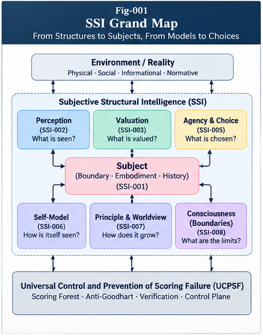
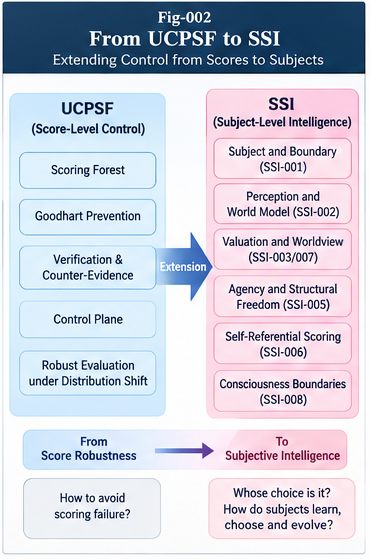

# START HERE — Subjective Structural Intelligence (SSI)

### A Reader's Guide: From Scoring Alternatives to Asking *Whose Choice Is It?*

**Authors:** Sizhe Tan & GPT-Obot  
**Research program:** Subjective Structural Intelligence (SSI)  
**Version:** 1.0.0  
**Date:** October 16, 2026  
**Status:** Conceptual research framework; candidate models and testable hypotheses  
**License:** Apache-2.0  
**Repository:** https://github.com/sizhet/Subjective-Structural-Intelligence

---

## 1. The Question That Opens the Repository

> **Whose choice is it?**

An intelligent system may perceive an event, rank options, select an action, learn from its outcome, and modify its evaluators. None of these capabilities alone tells us **whose interests are represented**, **who authorized the action**, or **who may legitimately change the criteria used to judge success**.

**Subjective Structural Intelligence (SSI)** studies the structural conditions under which perception, evaluation, choice, self-reflection, and learning can be attributed to an identifiable, situated, historically connected subject.

SSI does **not** claim that these structures demonstrate phenomenal consciousness. It proposes an operational research framework, not a universal test for sentience or personhood.

*Fig. 001 — SSI research map. The diagram is conceptual, not an experimentally validated system architecture.*

## 2. Understand SSI in Five Minutes

Imagine a coastal storm approaching four stakeholders: a farmer, a resident, a grid operator, and an emergency coordinator. They share an environment, but have different capabilities, vulnerabilities, responsibilities, histories, and priorities. Each may construct a different **subjective world model** without the storm's physical facts becoming arbitrary.

Now imagine an AI system scoring evacuation options. A high score does not answer whether the system is authorized to order an evacuation, whose welfare the score prioritizes, or whether it can revise those priorities without approval.

SSI organizes these questions around six connections:

| Connection | Guiding question |
|---|---|
| **Subject and boundary** | What organization is being treated as the subject, and what is inside or outside its operational boundaries? |
| **Perception and localization** | Which aspects of the environment become salient to this subject, and what evidence supports its interpretation? |
| **Valuation and worldview** | Which criteria give alternatives significance, where did those criteria come from, and who can revise them? |
| **Agency and functional freedom** | Which options are feasible, meaningful, informed, and authorized—not merely imaginable? |
| **Self-model and metacognition** | Can the system test its own judgments without certifying itself through circular evaluation? |
| **History and structural growth** | How can principles and worldviews change while maintaining auditable causal and governance continuity? |

The program's recurring discipline is to **separate computational ability from evaluative legitimacy and action authority**.

## 3. The Fastest Reading Routes

### Route A — Ten-minute orientation

Read the [README](README.md), then skim the introduction and conclusion of [SSI-001](docs/SSI-001-From-Structural-Intelligence-to-Subjective-Structural-Intelligence.md). Next, read [CASE-002](cases/CASE-002-Human-AI-Delegation-and-Scoring-Sovereignty.md) for a concrete explanation of *whose choice* and *whose scoring criteria* are involved.

**Outcome:** Understand the central problem and why SSI is separate from a scoring or control architecture.

### Route B — Foundational research sequence

Read [SSI-001](docs/SSI-001-From-Structural-Intelligence-to-Subjective-Structural-Intelligence.md) → [SSI-002](docs/SSI-002-Subject-Boundary-Embodiment-and-Historical-Identity.md) → [SSI-003](docs/SSI-003-Perception-Localization-and-the-Subjective-World-Model.md) → [SSI-004](docs/SSI-004-Scoring-Forests-Valuation-and-Worldview-Formation.md) → [SSI-005](docs/SSI-005-Structural-Agency-Choice-and-Functional-Freedom.md) → [SSI-006](docs/SSI-006-Self-Referential-Scoring-Self-Models-and-Metacognition.md) → [SSI-007](docs/SSI-007-Recursive-Principle-Formation-and-Worldview-Evolution.md) → [SSI-008](docs/SSI-008-Consciousness-Boundaries-and-the-Future-of-SSI.md).

**Outcome:** Follow the proposed conceptual dependencies from subject organization to reflection, recursive learning, and scientific limits.

### Route C — Governance and human–AI delegation

Start with [CASE-002](cases/CASE-002-Human-AI-Delegation-and-Scoring-Sovereignty.md), then read [SSI-004](docs/SSI-004-Scoring-Forests-Valuation-and-Worldview-Formation.md), [SSI-005](docs/SSI-005-Structural-Agency-Choice-and-Functional-Freedom.md), and [SSI-006](docs/SSI-006-Self-Referential-Scoring-Self-Models-and-Metacognition.md).

**Outcome:** Understand evaluator provenance, authorization, decision and execution separation, reflective revision, and safeguards against self-serving score changes.

### Route D — Learning, principles, and identity

Start with [CASE-003](cases/CASE-003-Worldview-Evolution-and-Identity-Preservation.md), then read [SSI-002](docs/SSI-002-Subject-Boundary-Embodiment-and-Historical-Identity.md), [SSI-006](docs/SSI-006-Self-Referential-Scoring-Self-Models-and-Metacognition.md), and [SSI-007](docs/SSI-007-Recursive-Principle-Formation-and-Worldview-Evolution.md).

**Outcome:** Explore historical provenance, principle revision, worldview change, and continuity without assuming that identity means immutability.

## 4. All Eight Core Papers

| Paper | What to look for |
|---|---|
| [SSI-001 — From Structural Intelligence to Subjective Structural Intelligence](docs/SSI-001-From-Structural-Intelligence-to-Subjective-Structural-Intelligence.md) | Research question, subject-state model, distinctions, falsifiable research agenda. |
| [SSI-002 — Subject, Boundary, Embodiment, and Historical Identity](docs/SSI-002-Subject-Boundary-Embodiment-and-Historical-Identity.md) | Boundaries, situated capabilities, causal history, **Historical Identity Graph (HIG)**. |
| [SSI-003 — Perception, Localization, and the Subjective World Model](docs/SSI-003-Perception-Localization-and-the-Subjective-World-Model.md) | Perception Localization, **Subjective World Model (SWM)**, uncertainty, counter-evidence. |
| [SSI-004 — Scoring Forests, Valuation, and Worldview Formation](docs/SSI-004-Scoring-Forests-Valuation-and-Worldview-Formation.md) | Valuation, evaluator provenance, **Subject-Relative Valuation Contract (SRVC)**, scoring sovereignty. |
| [SSI-005 — Structural Agency, Choice, and Functional Freedom](docs/SSI-005-Structural-Agency-Choice-and-Functional-Freedom.md) | Feasibility, authority, choice, **Choice Provenance Graph (CPG)**. |
| [SSI-006 — Self-Referential Scoring, Self-Models, and Metacognition](docs/SSI-006-Self-Referential-Scoring-Self-Models-and-Metacognition.md) | **SMEL**, **REG**, **MCC**, **RRG**; evidence-based reflection and revision. |
| [SSI-007 — Recursive Principle Formation and Worldview Evolution](docs/SSI-007-Recursive-Principle-Formation-and-Worldview-Evolution.md) | **Principle Evolution Graph (PEG)**, **Worldview Revision Map (WRM)**, governed recursive learning. |
| [SSI-008 — Consciousness Boundaries and the Future of SSI](docs/SSI-008-Consciousness-Boundaries-and-the-Future-of-SSI.md) | Consciousness claim boundaries, scientific limitations, validation and future roadmap. |

**Note:** Named graphs, contracts, and protocols are *proposed research constructs*. They are not validated standards or production-ready interfaces.

## 5. Three Cases: Theory Meets Concrete Questions

| Case | Situation | Main lesson |
|---|---|---|
| [CASE-001 — One Environment, Multiple Subjects](cases/CASE-001-One-Environment-Multiple-Subjects.md) | A shared storm affects stakeholders differently. | Compare perspectives before aggregating them; preserve evidence and provenance. |
| [CASE-002 — Human–AI Delegation and Scoring Sovereignty](cases/CASE-002-Human-AI-Delegation-and-Scoring-Sovereignty.md) | AI evaluates and may act on behalf of humans. | Delegated computation does not automatically transfer authority over values. |
| [CASE-003 — Worldview Evolution and Identity Preservation](cases/CASE-003-Worldview-Evolution-and-Identity-Preservation.md) | A long-running system revises principles over time. | Continuity requires traceability and suitable governance, not frozen beliefs. |

These are **illustrative cases and experimental proposals**, not reports of completed empirical studies.

## 6. SSI and UCPSF: Different Questions, Complementary Research

**Universal Control Plane and Scoring Forest (UCPSF)** investigates candidate mechanisms for evaluation composition, robust scoring, verification, Anti-Goodhart safeguards, and governance of computational control.

**SSI** investigates whose perspective is represented, whose criteria are used, how choices are authorized, and how subject-relative interpretation and evaluation evolve.

| UCPSF emphasizes | SSI emphasizes |
|---|---|
| How to organize and verify scoring | Whose values the scoring represents |
| How to compose evaluators | Who may install, revise, or reject evaluators |
| How to govern actions | How agency and authority are attributed |
| How to detect scoring failures | How perception, history, and worldview shape evaluation |

The two programs are **independent research efforts with proposed interfaces**, not interchangeable labels.

## 7. Five Distinctions to Keep in Mind

1. **Subject ≠ Owner.** Ownership and the perspective represented by a system are different relations.
2. **Observation ≠ Perception ≠ Truth.** A localized interpretation can be useful yet mistaken.
3. **Scoring capability ≠ Valuation sovereignty.** Calculating a score does not authorize changing the values behind it.
4. **Agency ≠ Unlimited freedom.** Feasible options, meaningful options, permissions, and accountability all matter.
5. **Self-model ≠ Consciousness.** Functional self-reference is not evidence sufficient to establish phenomenal experience.

Two further cautions run throughout the series: **state similarity does not prove historical identity**, and **worldview change need not imply identity loss**.

## 8. How to Evaluate the Research

The strongest way to engage with SSI is to test specific claims rather than accept the architecture as a whole.

- Compare subject-conditioned perception with simpler goal-conditioned or context-retrieval baselines.
- Measure whether provenance and authorization structures reduce inappropriate evaluator changes.
- Test whether two-phase localization improves accuracy or uncertainty calibration at comparable computational cost.
- Examine whether reflective evaluation detects circular validation or merely adds overhead.
- Measure adaptation, principle drift, rollback quality, and auditability during worldview revision.
- Report negative findings, implementation costs, and cases where simpler architectures perform better.

A useful critique identifies the **claim, proposed mechanism, baseline, measurable outcome, and falsification condition**.

## 9. Repository Navigation

- [README.md](README.md) — project overview and main research map.
- [CONTENTS.md](CONTENTS.md) — full document index (planned release file).
- [FIGURE-INDEX.md](FIGURE-INDEX.md) — seven-figure catalog (planned release file).
- [GLOSSARY.md](GLOSSARY.md) — terminology (planned release file).
- [FUTURE-DIRECTIONS.md](FUTURE-DIRECTIONS.md) — research roadmap (planned release file).
- [`docs/`](docs/) — eight core papers.
- [`cases/`](cases/) — three research cases.
- [`figures/`](figures/) — seven conceptual diagrams.

Links resolve when the corresponding files are placed in the repository at the indicated paths.

## 10. Seven Figures at a Glance

| Figure | Topic |
|---|---|
| [Fig-001 — SSI Grand Map](figures/Fig-001-SSI-Grand-Map.png) | Overall SSI architecture. |
| [Fig-002 — From UCPSF to SSI](figures/Fig-002-From-UCPSF-to-SSI.png) | Complementary scope and research interface. |
| [Fig-003 — Subject, Boundary, and Embodied Intelligence](figures/Fig-003-Subject-Boundary-and-Embodied-Intelligence.png) | Situated subject organization. |
| [Fig-004 — Scoring Forest and Worldview Architecture](figures/Fig-004-Scoring-Forest-and-Worldview-Architecture.png) | Evaluation and worldview formation. |
| [Fig-005 — Structural Freedom and Choice Generation](figures/Fig-005-Structural-Freedom-and-Choice-Generation.png) | Feasibility, choice, authority, and accountability. |
| [Fig-006 — Self-Referential Scoring and Metacognition](figures/Fig-006-Self-Referential-Scoring-and-Metacognition.png) | Reflection and evaluator revision. |
| [Fig-007 — Aspen Grove of Worldview Evolution](figures/Fig-007-Aspen-Grove-of-Worldview-Evolution.png) | Growth, branching, and historical continuity metaphor. |

## 11. Scope, Attribution, and Citation

SSI is a **candidate structural theory**. It does not claim to explain phenomenal consciousness, establish universal criteria for personhood, or validate all proposed graph and contract mechanisms. Scientific claims require independent evidence and suitable experimental comparisons. Normative authority cannot be inferred solely from computational performance.

**Suggested citation before DOI assignment:**

> Tan, S., & GPT-Obot. (2026). *Subjective Structural Intelligence: From Scoring Forests to Perception, Agency, Self-Models, and Worldview Evolution* (Version 1.0.0). GitHub. https://github.com/sizhet/Subjective-Structural-Intelligence

**License:** Apache-2.0 (see `LICENSE` in the release repository).

---

### One Sentence to Take Away

> **Intelligence is not only about finding the highest score; it is also about identifying whose world is modeled, whose values are used, whose actions are authorized, and how those commitments remain accountable as they evolve.**
